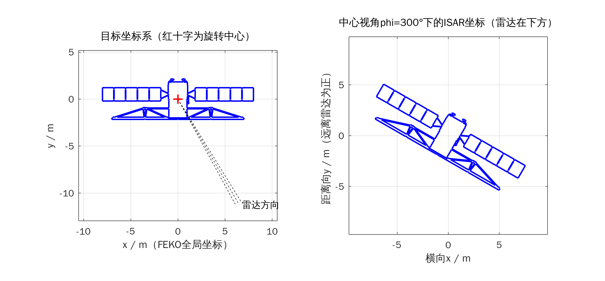

# 阶段1：方案与参数设计

> 《合成孔径雷达》课程大作业：基于 FEKO 电磁仿真数据的空间目标 ISAR 转台成像
> 本文配套脚本：`design_params.m`（自动算出下表所有参数，并输出 `params_table.md`、`figures/fig01_model_topview.png`）

> **更新（模型已更换）**：经讨论，目标模型改为 NASA 3D Resources 的 **RADARSAT-1**（`model/radarsat1_m.stl`，翼展约 16 m）。
> 设计分辨率相应放宽为 0.3 m：f0 = 10 GHz，B = 500 MHz，Δf = 5 MHz（101 个频点），φ = 298.5°~301.5°，Δφ = 0.03°（101 个角度）。
> 最新参数表见 `params_table.md`，由 `design_params.m` 自动生成。下文保留最初参数化卫星方案的分析过程，作为设计思路的记录。

## 1. 总体思路（转台成像）

FEKO 中目标静止，用平面波从一组方向照射，并在**入射方向**接收远场（单站后向散射），扫描
频率 $f\in[f_0-B/2,\,f_0+B/2]$ 与方位角 $\varphi\in[\varphi_c-\theta_m/2,\,\varphi_c+\theta_m/2]$，得到复数散射场
$E(f,\varphi)$。它等价于：步进频雷达在目标每个转角下测得的一组频域回波。

- 频率维 IFFT → 一维距离像（距离分辨率 $\rho_r=c/(2B)$）
- 方位维 FFT → 横向像（横向分辨率 $\rho_a=\lambda_0/(2\theta_m)$，课件第7章公式）
- 转角或带宽较大时，RD 近似失效，用极坐标格式算法（PFA）

**与 `ISAR_RD.m` 坐标的对应关系**（阶段3会用假数据再严格验证一次）：

| ISAR_RD.m | FEKO |
|---|---|
| 原点：目标旋转中心 O | 全局坐标原点（卫星本体中心） |
| y：距离向，远离雷达为正；雷达在 (0,−R0) | 参考雷达方向 θ=90°, φ=270°（−y 方向） |
| 目标绕 z 轴**顺时针**转过 θ | 目标不动，雷达方向**逆时针**转到 φ = 270° + θ |
| 旋转平面 xy | 雷达始终在 θ=90° 平面内扫 φ |

推导：散射点 r=(x,y)，雷达单位方向 u=(cosφ, sinφ)，远场斜距 R≈R0−r·u。令 φ=270°+θ，得
R≈R0−x·sinθ+y·cosθ，与 `ISAR_RD.m` 中顺时针转动后的 R0+y_rot 完全一致。所以 **φ 增大 = 目标顺时针转**。

## 2. 目标模型推荐

### 方案 A（推荐）：参数化“箱体+双帆板”卫星，直接在 CADFEKO 中建模

| 部件 | 尺寸 | FEKO 中的建法 |
|---|---|---|
| 本体 | 1.5 m × 1.5 m × 1.5 m 立方体，中心在原点 | Cuboid |
| 太阳帆板 ×2 | 2.5 m (x) × 1.2 m (z)，零厚度 PEC 薄板，位于 y=0 平面，直接贴在本体 ±x 面上 | Rectangle（在 xz 工作平面内） |
| 翼展 L | 1.5 + 2×2.5 = **6.5 m** | |

选择理由：

1. **尺寸合适**：6.5 m 翼展，在 X 波段约 228λ，属于典型电大目标，能体现高频散射机理。
2. **散射机理清晰、可解释**：帆板与本体侧面构成 90° 二面角（棱线沿 z 轴，雷达在 xy 平面内时为理想后向反射器，图1红星处）；
   φ=270° 附近有帆板/本体面的镜面闪烁；帆板端点、本体角点有边缘/角点绕射。汇报时可以把 ISAR 图上每个亮点对应到部件。
3. **全部是平面**：RL-GO/PO 求解时网格只需要描述几何（几十个三角形），不需要按 λ/8 剖分，计算量最小。
4. **MATLAB 端轮廓精确**：投影轮廓直接由同一组尺寸参数生成，叠加核对强散射点不会有配准误差。
5. **没有 STL 修复问题**：下载的 STL 常见非封闭、重叠面、法向错误，在 FEKO 中会导致 PO/RL-GO 照明判断出错。

阶段2我会提供 CADFEKO Lua 脚本，一键建出这个模型（脚本写法与 FEKO 版本相关，所以需要先知道你的版本）。

### 方案 B：下载 NASA 免费卫星模型（STL/OBJ）

- 来源：[NASA 3D Resources 网站](https://nasa3d.arc.nasa.gov/models) 或 GitHub 镜像
  [nasa/NASA-3D-Resources](https://github.com/nasa/NASA-3D-Resources)，素材免版权（使用前请看其 usage guidelines）。
- 选型建议：挑选“箱体+平板帆板”外形、细小部件少的卫星，翼展 3–15 m。
- 注意：这些模型是给 3D 打印/渲染做的，三角面常有几万到几十万个，细节（螺栓、天线支架）对 ISAR 意义不大却显著增加计算量。
  建议先在免费软件 MeshLab 中：`Filters → Remeshing, Simplification → Quadric Edge Collapse Decimation` 简化到约 1–2 万面，
  `Filters → Cleaning and Repairing` 删除重复顶点/重叠面，`Filters → Normals → Re-Orient all faces coherently` 统一法向；
  再用 `Filters → Normals, Curvatures and Orientation → Transform: Scale` 缩放到真实尺寸（单位 m）。
- 我没有逐个核实 NASA 库中具体哪个模型最合适；如果你选方案 B，把选中的模型发给我，我可以写脚本检查它的尺寸、面数和封闭性。
  `design_params.m` 中把 `model_mode` 改为 `'custom'`、`L_custom` 改为实际最大尺寸即可重算参数。

### CADFEKO 中导入 STL（方案 B）要点

> 菜单名称在不同版本间有差异，阶段2会按你的版本写到具体对话框。

1. **单位**：STL 文件本身没有单位。导入前先确认 CADFEKO 的模型单位（通常在“Home/Construct”页的 *Model unit* 或
   导入对话框的 *Scale factor*）；若 STL 是 mm 而模型单位是 m，导入比例填 0.001。导入后用测量工具核对翼展。
2. **导入方式**：`Import → Mesh → STL`。STL 进入 CADFEKO 是**网格（mesh）**而不是 CAD 几何，后续不再自动重新剖分。
3. **材料**：选中网格的所有面 → *Properties → Medium* 选 **Perfect electric conductor (PEC)**（FEKO 面的默认介质一般就是 PEC，仍需检查）。
4. **网格/求解方法**：
   - RL-GO/LE-PO：在面属性的 *Solution* 页把求解方法设为 RL-GO（或 PO + Large element），STL 原网格可直接用；
   - MoM/MLFMM：需要 λ/8~λ/10 的网格，必须 *Remesh*，在 X 波段对 6.5 m 目标不可行（见第4节）。
5. **位置**：把卫星本体中心平移到原点（旋转中心），帆板展向沿 x 轴，这样 FEKO 坐标与 `ISAR_RD.m` 约定直接对应。

## 3. 参数表（`design_params.m` 运行结果）

| 参数 | 符号 | 数值 | 说明 |
|---|---|---|---|
| 目标最大尺寸 | L | 6.50 m | 电尺寸约 228 λ |
| 中心频率 | f0 | 10.00 GHz | λ0 = 3.00 cm（X 波段） |
| 带宽 | Br | 1000 MHz | 9.500~10.500 GHz |
| 频率步进 | Δf | 10.00 MHz | 上限 c/(2·1.5L) = 15.38 MHz |
| 频点数 | Nf | 101 | |
| 不模糊距离 | c/(2Δf) | 15.00 m | > 1.5L = 9.75 m |
| 总转角 | θm | 6.00° | φ: 297.000°~303.000° |
| 角度步进 | Δφ | 0.0800° | 上限 λmin/(2·1.5L) = 0.0839° |
| 角度点数 | Naz | 76 | |
| 横向不模糊窗 | λmin/(2Δφ) | 10.23 m | > 9.75 m |
| 距离分辨率 | ρr = c/(2Br) | 0.150 m | 矩形窗 |
| 横向分辨率 | ρa = λ0/(2θm) | 0.143 m | 矩形窗 |
| 极化 | | VV | 平面波 η=0°，接收 Eθ |
| 雷达俯仰 | θ | 90° | 雷达在转台平面内 |
| 单站解总数 | Nf×Naz | 7676 | 另加 RCS 曲线 721 点 |

设计说明：

- **Δφ 用最高频 λmin 计算**：横向不模糊窗 λ/(2Δφ) 在最高频最小，按它设计最保守。
- **中心方位 φc=300°**：雷达从帆板斜前方 30° 观测，正好落在右侧二面角的后向反射区（φ∈270°~360°），
  同时避开 φ=270° 的帆板镜面闪烁（那里一个点会比其他散射中心强 30 dB 以上，把图像其余部分压没）。
  如果想展示镜面闪烁，可另做一组 φc=270° 的扫描对比。
- **极化选 VV**（FEKO 平面波极化角 η=0°，θ=90° 时电场沿 −z，即竖直）：与帆板端部竖直棱边平行，边缘回波较强；
  90° 二面角对 VV/HH 都是强后向反射（两者相位相差 π）。HH 需要再算一遍，作为可选对比。
- **RD 适用性检查**（脚本自动打印）：中心视角下最大横向 |x|=2.81 m，
  转动距离徙动 ≈ x·θm = 0.30 m（> 半个距离单元 0.075 m），二次相位误差 ≈ 1.87 rad（> π/4），
  带宽引起的横向尺度展宽 ≈ x·B/f0 = 0.28 m。**结论：RD 图中心清晰、帆板端部会展宽散焦，PFA 能校正**——
  这正好作为“RD vs PFA 对比”的汇报素材。若只想用 RD，可把 θm 降到 3°（ρa≈0.29 m）。

## 4. 求解器选择与计算量

| 求解器 | 原理 | 网格要求 | 本目标 X 波段可行性 | 能否得到二面角/多次反射 |
|---|---|---|---|---|
| MoM | 全波，精确 | λ/8~λ/10 | 约 6.9×10⁶ 未知量，直接 MoM 矩阵约 7×10⁵ GB，**不可行** | 能 |
| MLFMM | 全波，快速多极子 | λ/8~λ/10 | 内存数十 GB 量级，×101 个频点，**普通 PC 不可行** | 能 |
| PO（常规） | 高频近似，照明区感应电流 | 仍需按 λ 剖分 | 网格太大，不推荐 | 需开启多次反射（ray tracing） |
| LE-PO（大单元 PO） | PO，单元内相位解析积分 | 只需描述几何 | 可行 | 视版本设置 |
| **RL-GO（推荐）** | 射线发射几何光学 + 物理光学积分（类似 SBR） | 只需描述几何 | **可行，平板目标仅几十个三角形** | **能（多次反射）** |

推荐：**主扫描用 RL-GO**（二面角的双次反射是本模型最重要的散射中心，必须包含多次反射）；
缺点是不含边缘绕射修正和爬行波，帆板端点等边缘回波会偏弱——这一点写进“不足”。
如果时间允许，可以在低频（如 1 GHz，模型电尺寸约 22λ）单频、几个角度上用 MLFMM 与 RL-GO 对比 RCS，说明高频近似的误差。

**计算量**：主扫描 101×76 = 7676 个单站解，加一条 f0 单频、φ=0:0.5:360 的 RCS 曲线 721 个解。
RL-GO 每个解的耗时取决于你的电脑、射线密度和反射次数，**我无法预估准确值**；`design_params.m` 中暂按 0.5 s/点估计约 1.2 h。
建议先只算 1 个频点 × 76 个角度试算，用实测耗时替换 `t_per_point`。

**一个重要结论**：样本总数 ≈ Nf×Naz ≈ (1.5L/ρr)×(1.5L/ρa)，只由“目标占多少个分辨单元”决定，**与中心频率无关**。
所以单纯降频或缩小模型并不能减少扫描点数；它们减少的是电尺寸（全波网格规模）。若计算量太大：

| 方案 | 做法 | 扫描点数 | 代价 |
|---|---|---|---|
| ① 放宽余量 | os_ua 由 1.5 降到 1.2，手动取 Δf=15 MHz、Δφ=0.1° | 约 68×61 ≈ 4100 | 不模糊窗只比目标大 20%，边缘可能轻微混叠 |
| ② 降低分辨率 | ρ ≈ 0.25 m（B=600 MHz、Δf=10 MHz，θm=3.5°） | 约 61×45 ≈ 2700 | 图像变粗，帆板约 10 个单元 |
| ③ 降频（全波验证用） | f0 = 1 GHz、模型不变 | 点数不变 | 电尺寸降到约 22λ，MLFMM 可算单频少量角度，但成像分辨率不可用 |
| ④ 缩小模型 | 等价于降频（电尺寸相同即结果相同） | 同③ | 同③ |

## 5. 待确认事项

1. FEKO 版本号与许可类型（商业版 / 学校许可 / Altair Student Edition），学生版可能有网格规模或求解器限制。
2. MATLAB 版本（决定能否使用 `stlread`、本地函数、`exportgraphics` 等）。
3. 模型选方案 A（参数化卫星）还是方案 B（NASA 下载模型）。
4. 参数表是否接受（尤其 φc=300°、θm=6°、VV 极化）。
